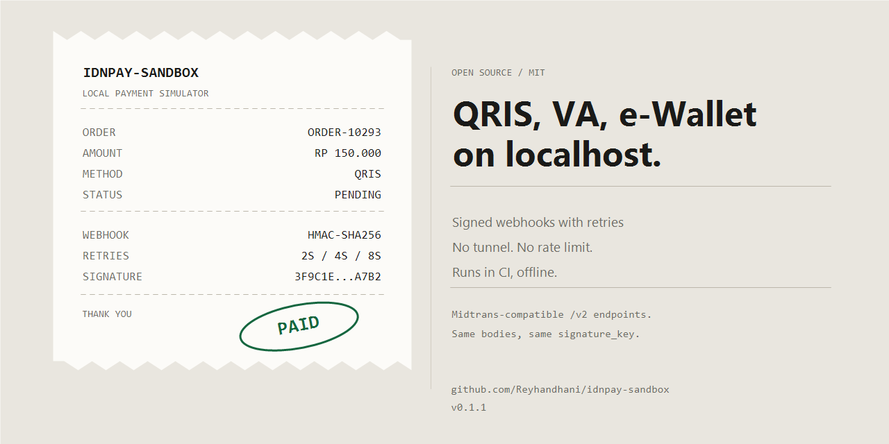
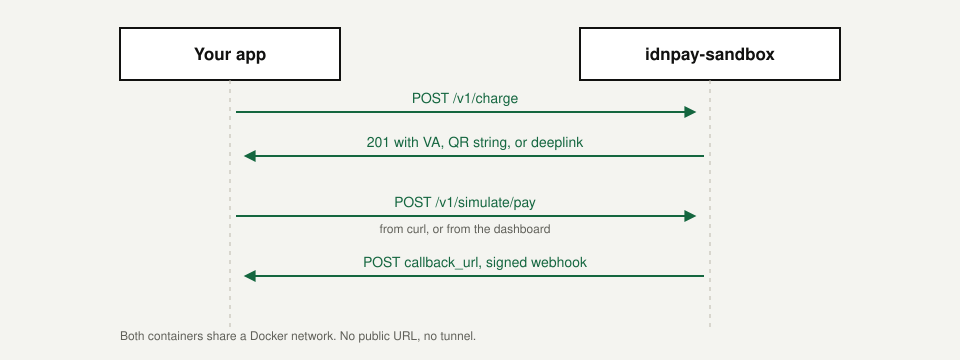
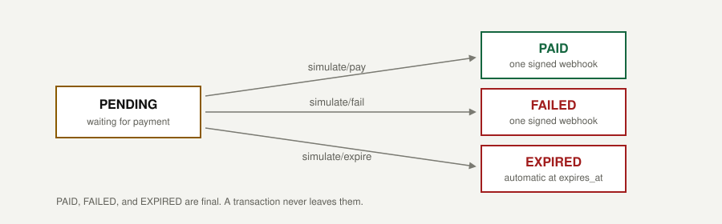

# idnpay-sandbox

[](https://github.com/Reyhandhani/idnpay-sandbox/actions/workflows/ci.yml)
[](https://www.npmjs.com/package/idnpay-sandbox)
[](LICENSE)
[](package.json)
[](https://github.com/Reyhandhani/idnpay-sandbox/releases)



A local payment gateway simulator for Indonesia. Use it to test QRIS, Virtual Account, and e-Wallet flows without a third-party sandbox that goes down or rate limits you.

Webhooks are signed with HMAC-SHA256, so you can test signature verification on your side too.

## Why use this

A payment sandbox is a shared service on someone else's network, and that shape causes four problems during development.

### Your CI depends on their uptime

Rate limits, maintenance windows, and network latency turn a green build into a flaky one. This simulator runs as a container in the same job, answers in milliseconds, and needs no internet. The recipe for GitHub Actions is in [docs/CI.md](docs/CI.md).

### You cannot force the failure you wrote code for

Provider sandboxes test the happy path. Here you can return 504 from every call with `SIMULATED_FAILURE_STATUS`, let a webhook fail three times in a row to exercise the retry queue, or post a body with a wrong HMAC to prove your app rejects it.

### Webhooks do not need a public URL

Both containers share a Docker network, so `callback_url` points at a service name. No tunnel, no exposed laptop, and no callback that breaks when your connection drops.

### Global tools do not model Indonesian rails

Stripe CLI tests cards. This project models QRIS with an EMVCo payload and CRC-16, Virtual Accounts for BCA, Mandiri, BRI, BNI, and Permata, and e-Wallet deeplinks for GoPay, OVO, ShopeePay, and DANA.



## Coming from Midtrans?

Point your base URL at the simulator and use `SECRET_KEY` as the Basic auth username with an empty password. Request bodies stay the same.

- `POST /v2/charge` accepts `transaction_details`, `payment_type`, and `callback_url`
- `GET /v2/{order_id}/status` returns the same fields you already read
- Webhooks carry `signature_key`, computed with SHA512 exactly as Midtrans documents

Snap, cards, refunds, and payouts are not supported. The full mapping is in [docs/MIDTRANS.md](docs/MIDTRANS.md).

## How it compares

|                                        | Provider sandbox | Stripe CLI | idnpay-sandbox |
| -------------------------------------- | ---------------- | ---------- | -------------- |
| Runs offline                           | No               | Partly     | Yes            |
| Account required                       | Yes              | Yes        | No             |
| Force 504 or repeated webhook failures | No               | No         | Yes            |
| Indonesian rails (QRIS, VA, e-Wallet)  | Yes              | No         | Yes            |
| Real bank numbers and settlement       | Yes              | n/a        | No             |
| Production use                         | Sandbox only     | No         | No             |
| Midtrans-compatible requests           | It is Midtrans   | No         | Subset         |

### What it is not

It does not move real money, does not implement bank settlement rules, and its Virtual Account prefixes are illustrative rather than official bank numbers. Use it to test your integration, not to model a bank.

## What it includes

- Transaction states `PENDING`, `PAID`, `FAILED`, and `EXPIRED`, driven by simulation endpoints
- Signed webhooks with retries and exponential backoff
- Redis queue (optional). Without Redis, the queue runs in memory
- Configurable latency, failure rate, and failure status for resilience testing
- A browser dashboard for trying flows without writing code

## Try it

Docker Compose builds the image and starts the simulator with Redis.

```bash
docker compose up -d --build
```

Run the same command after pulling changes, otherwise Docker keeps the old image.

Or run the published package without cloning, on Node.js 22 or newer:

```bash
npx idnpay-sandbox
```

Then open `http://localhost:9000` and use the dashboard, or follow these three calls.

1. Create a charge:

```bash
curl -X POST http://localhost:9000/v1/charge \
  -H "Content-Type: application/json" \
  -H "X-Client-Key: idnpay-dev-client-key" \
  -d '{
    "order_id": "ORDER-10293",
    "gross_amount": 150000,
    "payment_type": "qris",
    "callback_url": "http://host.docker.internal:8000/api/payments/webhook"
  }'
```

2. Copy `transaction_id` from the response and mark it paid:

```bash
curl -X POST http://localhost:9000/v1/simulate/pay \
  -H "Content-Type: application/json" \
  -H "X-Client-Key: idnpay-dev-client-key" \
  -d '{ "transaction_id": "trx-..." }'
```

3. Watch your `callback_url` receive a webhook with `transaction_status` set to `PAID`.

Without Docker, use Node.js 22 or newer:

```bash
npm ci
npm run build
npm start
```

For auto-reload during development, run `npm run dev`. Settings can live in a `.env` file; see `.env.example`.

## Connecting your app

If the simulator runs in Docker and your app runs on the host, use `host.docker.internal` in `callback_url`. Inside a container, `localhost` points at the container itself, not your machine.

| Your app                | Simulator | `callback_url`                           |
| ----------------------- | --------- | ---------------------------------------- |
| Host                    | Docker    | `http://host.docker.internal:<port>/...` |
| Host                    | Host      | `http://localhost:<port>/...`            |
| Container in same stack | Docker    | `http://<service-name>:<port>/...`       |

## States and payment methods



| `transaction_status` | `status_code` | Meaning             |
| -------------------- | ------------- | ------------------- |
| `PENDING`            | `201`         | Waiting for payment |
| `PAID`               | `200`         | Payment received    |
| `FAILED`             | `202`         | Payment failed      |
| `EXPIRED`            | `407`         | Past `expiry_time`  |

Final states never change again, and every state change sends exactly one webhook.

| `payment_type`  | Extra field                                       | Response field |
| --------------- | ------------------------------------------------- | -------------- |
| `qris`          | –                                                 | `qr_string`    |
| `bank_transfer` | `bank`: `bca`, `mandiri`, `bri`, `bni`, `permata` | `va_number`    |
| `ewallet`       | `ewallet`: `gopay`, `ovo`, `shopeepay`, `dana`    | `deeplink_url` |

Virtual Account numbers use a different prefix per bank so they are easy to recognize in logs. These prefixes are illustrative, not real bank numbers. Deeplinks follow each provider's scheme but do not open a real app.

## FAQ

**Is it a drop-in replacement for the Midtrans sandbox?**
For charge, status, and webhook flows it covers the subset listed in [docs/MIDTRANS.md](docs/MIDTRANS.md). Snap, cards, refunds, and payouts are not implemented.

**Does any real money move?**
No. Nothing connects to a bank, and the Virtual Account numbers are illustrative.

**Can I run it in CI?**
Yes. Start it as a service container in the same job and point `callback_url` at the service name. [docs/CI.md](docs/CI.md) has the workflow.

**My app runs on the host. Where do webhooks go?**
Use `host.docker.internal` in `callback_url`. The table under [Connecting your app](#connecting-your-app) covers the other combinations.

**How do I test a webhook that fails?**
Point `callback_url` at an endpoint that returns 503. The simulator retries with a delay of `2^n` seconds until `WEBHOOK_RETRY_LIMIT` (5 by default), and every attempt is signed.

### Bahasa Indonesia

**Apa ini bisa menggantikan sandbox Midtrans?**
Untuk charge, cek status, dan webhook, bisa, sebatas yang tercantum di [docs/MIDTRANS.md](docs/MIDTRANS.md). Snap, kartu, refund, dan payout belum ada.

**Ada uang sungguhan yang berpindah?**
Tidak. Tidak ada koneksi ke bank, dan nomor Virtual Account di sini hanya contoh.

**Bisa dipakai di CI?**
Bisa. Jalankan sebagai service container di job yang sama, lalu arahkan `callback_url` ke nama service. Contoh workflow-nya ada di [docs/CI.md](docs/CI.md).

**Aplikasi saya jalan di host, webhook dikirim ke mana?**
Pakai `host.docker.internal` di `callback_url`. Kombinasi lain ada di tabel [Connecting your app](#connecting-your-app).

**Gimana cara ngetes webhook yang gagal?**
Arahkan `callback_url` ke endpoint yang membalas 503. Simulator mencoba ulang dengan jeda `2^n` detik sampai `WEBHOOK_RETRY_LIMIT` (default 5), dan setiap percobaan tetap ditandatangani.

## Documentation

- [API](docs/API.md): endpoints, request and response formats, error codes
- [Midtrans](docs/MIDTRANS.md): the compatible subset and its limits
- [Webhooks](docs/WEBHOOK.md): payload, signature verification, retries
- [Configuration](docs/CONFIGURATION.md): every environment variable
- [Architecture](docs/ARCHITECTURE.md): how the pieces fit and what happens on failure
- [CI](docs/CI.md): run it in GitHub Actions, edge-case recipes
- [Design](DESIGN.md): the visual direction and the reasons behind it
- [Deployment](docs/DEPLOYMENT.md): why it needs a container, not serverless
- [Contributing](CONTRIBUTING.md)
- [Code of conduct](CODE_OF_CONDUCT.md)
- [Security](SECURITY.md)
- [Changelog](CHANGELOG.md)

## Development

```bash
npm ci
npm run ci              # format, lint, typecheck, tests with coverage, build
npm test                # tests only
npm run test:coverage   # tests with the coverage gate (90% lines, 85% branches and functions)
```

Redis integration tests only run when `TEST_REDIS_URL` is set:

```bash
TEST_REDIS_URL=redis://127.0.0.1:6379 npm test
```

Layout:

```text
src/
  config/       configuration and constants
  controllers/  request handlers
  plugins/      auth, network simulation, error handling
  queues/       webhook queue (memory and Redis) and worker
  routes/       endpoints and validation schemas
  services/     transaction state, payment details, webhooks, QRIS
  app.ts        application wiring
  index.ts      process entry point
public/         dashboard
test/           unit and integration tests
```

## Security

This is a development tool, not a production service. Change `CLIENT_KEY` and `SECRET_KEY` before exposing it to anyone else. See [SECURITY.md](SECURITY.md).

## License

MIT. See [LICENSE](LICENSE).
